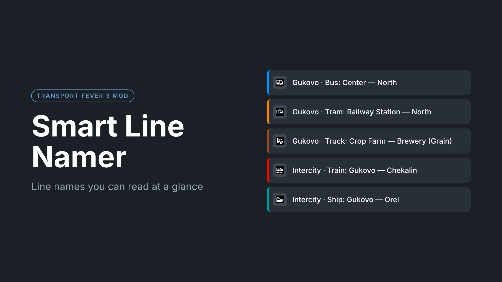
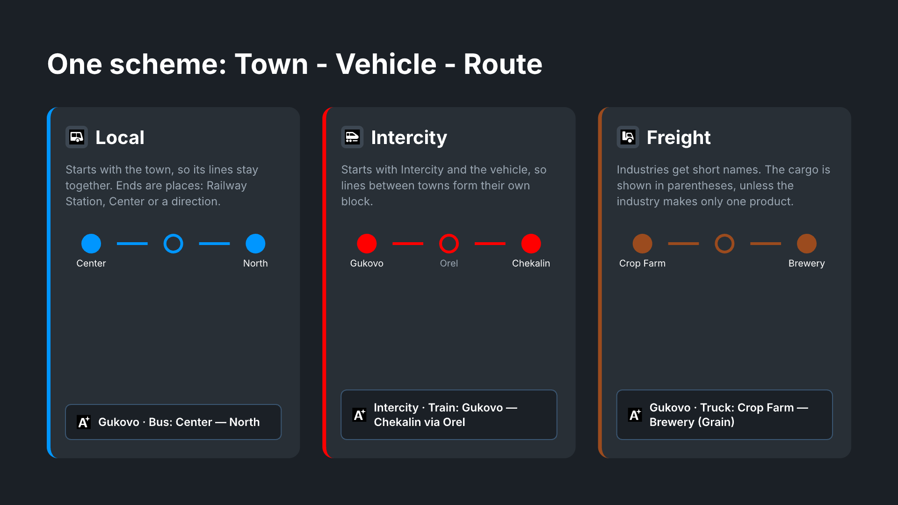

<h1 align="center">🚌 Smart Line Namer</h1>

<strong>Line names you can read at a glance — for Transport Fever 3.</strong>

  
  
  
  

Tired of <code>Line 14</code>, <code>Line 15</code>, <code>Line 16</code>? Smart Line Namer adds an auto-rename scheme that gives every line a name telling you what it is and where it goes, so you can find the right line in a long list without opening it.

<h2>Name format</h2>

<table>
  <tr><th>Line</th><th>Name</th></tr>
  <tr><td>Inside a town</td><td><code>Gukovo · Bus: Center — North</code></td></tr>
  <tr><td>Circular, inside a town</td><td><code>Gukovo · Bus: Loop</code></td></tr>
  <tr><td>Between towns</td><td><code>Intercity · Train: Gukovo — Chekalin</code></td></tr>
  <tr><td>Through several towns</td><td><code>Intercity · Train: Gukovo — Chekalin via Orel</code></td></tr>
  <tr><td>Circular, through several towns</td><td><code>Intercity · Bus: Gukovo (Loop)</code></td></tr>
  <tr><td>Freight</td><td><code>Gukovo · Truck: Crop Farm — Brewery (Grain)</code></td></tr>
  <tr><td>Freight, cargo obvious from the industry</td><td><code>Gukovo · Truck: Quarry — Cement Plant</code></td></tr>
  <tr><td>Same name as another line</td><td><code>Gukovo · Bus: Center — North 2</code></td></tr>
</table>

<h3>Why this order</h3>

The game sorts the line list alphabetically, so the first word decides where a line ends up:

<ul>
  <li>all lines of a town stay together, grouped by vehicle;</li>
  <li>all intercity lines form their own block, grouped by vehicle.</li>
</ul>

<h2>How names are built</h2>
<ul>
  <li><strong>Town</strong> — the town of the first stop. An industry stop counts as part of the closest town.</li>
  <li><strong>Vehicle</strong> — bus, truck, tram, train, plane or ship, taken from the line's vehicles, or from its stations when it has no vehicles yet.</li>
  <li><strong>Local route</strong> — the first and last stop, each named by its place in the town (see below).</li>
  <li><strong>Intercity route</strong> — the town of the first stop, the town at the other end, and the town with the most stops in between (<em>via</em>). The <em>via</em> part is left out when the name would be longer than 45 characters, so it still fits the line list.</li>
  <li><strong>Loop</strong> — the line ends at the station where it started.</li>
  <li><strong>Cargo</strong> — freight lines show the cargo loaded at the most stops, plus a count of the others (<code>Coal, +2</code>). It is left out when the cargo is loaded only at industries that make a single product (mines, quarries, sand and clay pits, logging camps, oil, fishing grounds): <code>Quarry — Cement Plant</code> needs no <code>(Stone)</code>.</li>
  <li><strong>Numbers</strong> — lines that would get the same name are numbered by creation order. Renaming again keeps the same numbers.</li>
</ul>

<h3>Stop names</h3>

Each stop is named by what it is or where it is in its town, in this order:

<table>
  <tr><th>Stop</th><th>Name</th></tr>
  <tr><td>At an industry</td><td>short industry name: <em>Coal Mine</em>, <em>Crop Farm</em>, <em>Refinery</em> (in Russian: <em>Шахта</em>, <em>Агроферма</em>, <em>НПЗ</em>)</td></tr>
  <tr><td>Airport, harbor</td><td><em>Airport</em>, <em>Port</em></td></tr>
  <tr><td>Rail station closest to the center</td><td><em>Railway Station</em> (<em>ЖД вокзал</em>)</td></tr>
  <tr><td>Bus terminal closest to the center</td><td><em>Bus Station</em> (<em>Автовокзал</em>)</td></tr>
  <tr><td>Near the town center</td><td><em>Center</em></td></tr>
  <tr><td>Near the industrial district</td><td><em>Industrial Zone</em></td></tr>
  <tr><td>Anywhere else</td><td>direction from the center: <em>North</em>, <em>South</em>, <em>East</em>, <em>West</em></td></tr>
</table>

Two stops of a town with the same name are numbered: <em>North</em>, <em>North 2</em>. Vanilla station names are not used, so names look the same in every town. Industries from other mods keep their own name.

<h2>How to use</h2>

Open the line manager, select one or more lines, press the auto-rename (wand) button and choose <strong>Town - Vehicle - Route</strong>. The vanilla schemes are still available.

<h2>Installation</h2>

Subscribe on <a href="https://mod.io/g/transportfever3">mod.io</a>, or download the zip from <a href="https://github.com/isNightmareDream/tf3-smart-line-namer/releases">Releases</a> and copy the <code>isnightmaredream_smart_line_namer</code> folder into the game's <code>staging_area</code> directory.

The mod only sets line names, so it is safe to add or remove at any time. Names stay after removing it.

<h2>Changes since 0.1.0</h2>
<ul>
  <li>The <strong>Vehicle - Route</strong> and <strong>Vehicle - Stops</strong> schemes are replaced by a single <strong>Town - Vehicle - Route</strong> scheme. Lines renamed with the old schemes keep their names until you rename them again.</li>
  <li>Names start with the town or with <em>Intercity</em>, so the alphabetical list groups lines by town and keeps intercity lines in their own block.</li>
  <li>Freight lines show their cargo. Circular lines are marked as <em>Loop</em>. Intercity lines show the main town in between (<em>via</em>).</li>
  <li>Lines that would get the same name are numbered instead of keeping their default <code>Line N</code> name.</li>
  <li>The town-center radius for directions now scales with the town, instead of a fixed 400 m.</li>
  <li>Stops are named by place (Railway Station, Bus Station, Center, Industrial Zone, a direction) and industries by a short name, instead of the vanilla station names.</li>
  <li>The cargo is left out when it is obvious from the industry; <em>via</em> is left out when the name would not fit the line list.</li>
  <li><strong>Fixed:</strong> 0.1.0 corrupted names with Cyrillic letters (for example <code>Лесопи�ка</code>), and opening such a line crashed the game. 0.2.0 repairs these names automatically the first time you open the auto-rename dialog.</li>
</ul>

<h2>Development</h2>

For local testing, copy the repository contents (<code>mod.json</code>, <code>strings.json</code>, <code>_metadata</code>, <code>content</code>) into <code>staging_area/isnightmaredream_smart_line_namer/</code> in the game's user data folder, then enable the mod in the game.

For type checking and autocomplete in <code>.tl</code> files, use the game's <code>vscode-template/</code> (<code>tlconfig.lua</code> points at <code>api/tealdef</code> and <code>base/tealdef</code>) with a Teal extension for VS Code.

Releases are built by GitHub Actions: pushing a <code>v*</code> tag (for example <code>v0.2.0</code>) packs the mod into <code>tf3-smart-line-namer-&lt;version&gt;.zip</code> and attaches it to a GitHub release.

<h2>Project layout</h2>
<ul>
  <li><code>content/gui/line_vehicle_mgmt/auto_rename/smart_line_namer_core.tl</code> — line names.</li>
  <li><code>content/gui/line_vehicle_mgmt/auto_rename/slnamer_stations.lua</code> — stop names (place, industry, numbering).</li>
  <li><code>content/gui/line_vehicle_mgmt/auto_rename/scheme_components/</code> — the scheme component that calls the core.</li>
  <li><code>content/gui/line_vehicle_mgmt/auto_rename/schemes/</code> — the scheme shown in the auto-rename menu.</li>
  <li><code>strings.json</code> — English and Russian translations, including short industry names (<code>ind_*</code> keys).</li>
  <li><code>_metadata/</code> — mod info, cover (<code>0.png</code>) and gallery images (<code>1.png</code>, <code>2.png</code>).</li>
  <li><code>.github/workflows/release.yml</code> — builds the release zip from a tag.</li>
</ul>

<h2>License</h2>

MIT © 2026 isNightmareDream

